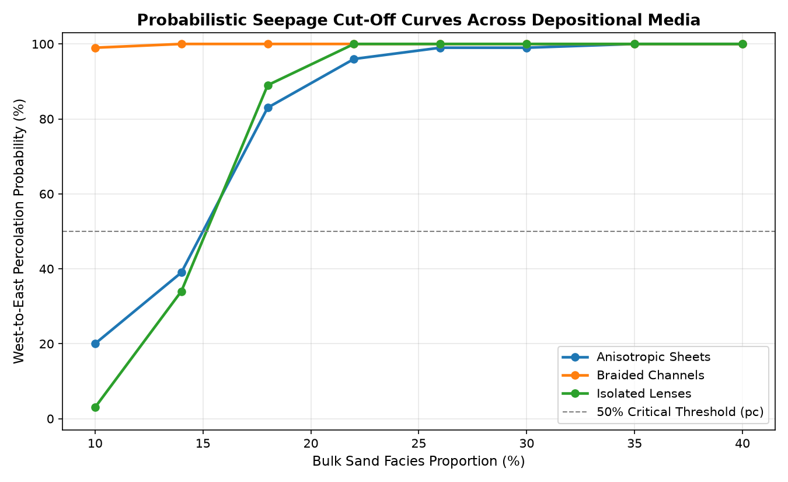
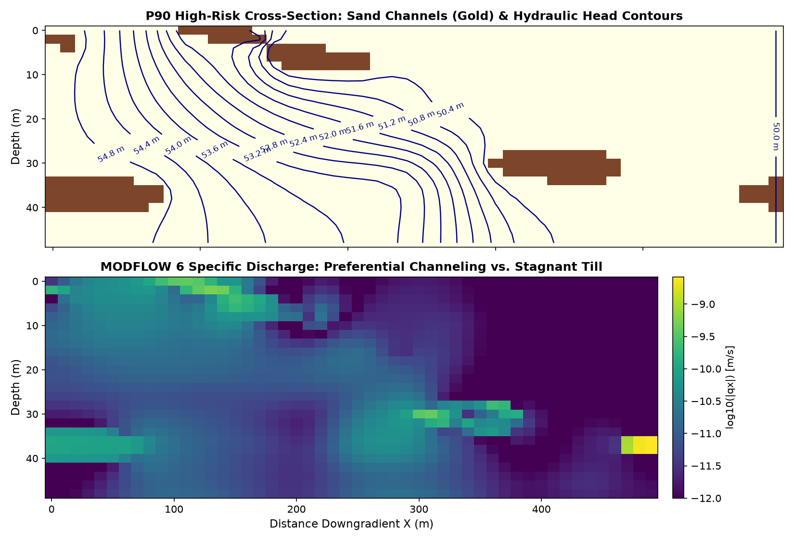

# hyproj: 3D Percolation & MODFLOW 6 Preferential Seepage Pipeline

**Stochastic Subsurface Connectivity Screening & Numerical Groundwater Flow Modeling**

## Overview
Deterministic groundwater models often average sparse borehole logs into homogeneous hydrostratigraphic layers, masking connected high-permeability sand channels embedded in low-permeability glacial till. **hyproj** bridges **3D geophysical synthesis**, **continuum percolation theory (Hoshen-Kopelman 6-connectivity)**, and **USGS MODFLOW 6 (flopy)** to quantify preferential seepage breakthrough risk.

## Key Capabilities
- **3D Spectral Geological Synthesis (hyproj.geology)**: Generates anisotropic 3D Gaussian Random Fields via FFT, petrophysical Gamma Ray (API) logs, and heterogeneous hydraulic conductivity (K) realizations.
- **Percolation Triage (hyproj.percolation)**: Screens hundreds of 3D realizations in parallel (joblib) to identify West-to-East spanning sand clusters, percolation thresholds (pc), order parameters, and geodesic tortuosity.
- **MODFLOW 6 Integration (hyproj.modflow_engine)**: Executes full 3D steady-state PDE solves on percolation-screened P10/P50/P90 realizations alongside deterministic geometric (KG) and arithmetic (KA) baselines.
- **Scalable Data Pipeline (hyproj.pipeline)**: YAML-configured batch execution exporting columnar **Parquet** analytics tables and labeled 3D **NetCDF** grids (xarray).

## Quickstart
1. Create and activate a virtual environment: python -m venv .venv && .venv\Scripts\activate
2. Install package in editable mode: pip install -e .
3. Execute pipeline: hyproj-run --config config/simulation_config.yaml

## Visual Diagnostics

